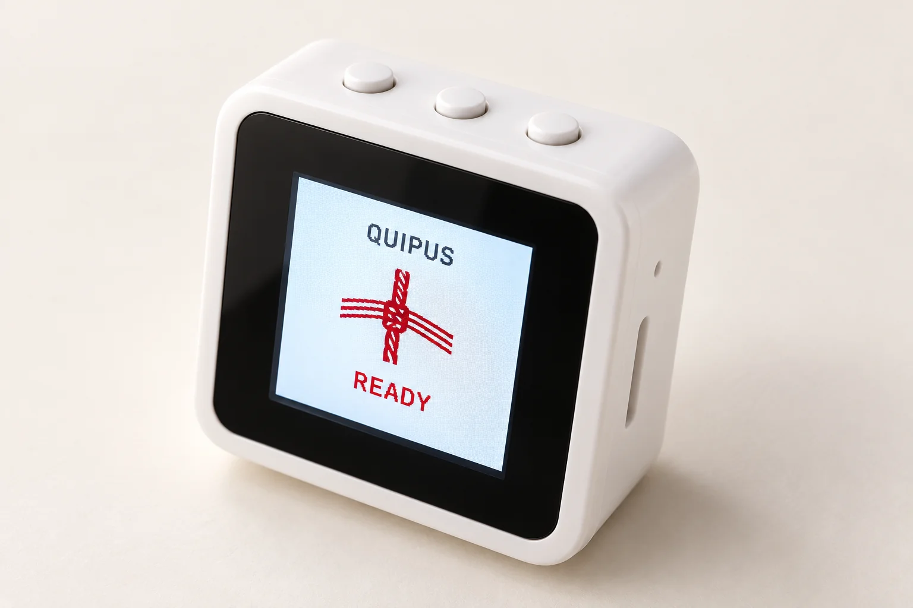
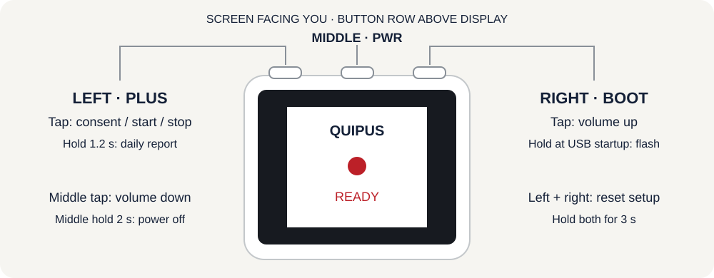

# Quipus

Quipus records conversations with consent and turns them into a transcript,
meeting brief and follow-up tasks. Review proposed meetings in the dashboard
before sending Google Calendar invitations.



*Illustrative device render. The button diagram below defines the controls;
physical testing is still required for each new firmware build.*

[Open dashboard](https://quipus-sales-rep-assistant.vercel.app) ·
[Download firmware](https://github.com/NathanHor22/Quipus/actions/workflows/waveshare-firmware.yml) ·
[Full Waveshare guide](hardware/lantern-firmware/WAVESHARE.md) ·
[Developer setup](docs/configuration.md)

## Start with the recorder

This guide is for the **Waveshare ESP32-S3-LCD-1.54 non-touch board** with
16 MB flash and 8 MB PSRAM. Other supported boards need their own firmware.

1. Insert a **FAT32 microSD card** with the recorder powered off. Recording
   requires the card; setup and reports can work without it. Back up existing
   files before formatting a card. Quipus never formats cards automatically.
2. Connect USB-C power. For firmware **0.10.2**, open a successful
   [Waveshare firmware build](https://github.com/NathanHor22/Quipus/actions/workflows/waveshare-firmware.yml),
   download its `quipus-waveshare-lcd-154` artifact, extract it, then extract
   the firmware ZIP inside. Follow `README.txt` to flash all five images
   together. The manifest identifies the version, source commit and hashes.
3. In **Chrome on Windows or Android**, sign in at
   [Devices](https://quipus-sales-rep-assistant.vercel.app/dashboard/devices), choose
   **Connect with Bluetooth**, and select `Quipus-BT-XXXX`. Enter the LCD PIN
   if the operating system asks. Provide a **2.4 GHz Wi-Fi** network and choose
   **Save and connect**. Wait for this recorder to appear online in your account.
4. On **iPhone/Safari**, create a pairing code in Devices and use the
   [Wi-Fi setup fallback](hardware/lantern-firmware/WAVESHARE.md#wi-fi-fallback-and-recording-controls).
   Bluetooth is used for setup on supported browsers; recordings upload over Wi-Fi.
5. When the screen says **READY**, tap the **left button** to request recording.
   Ask everyone for consent and follow the spoken/display prompt. Confirm the
   screen says **RECORDING** before relying on capture.
6. Tap **left** again to stop. Keep the recorder powered while it saves and
   uploads. Open the conversation in the dashboard to check its audio,
   transcript and brief. Review any proposed meeting before approving an invite.

## Which button is which?

**Face the screen with its text upright and the three buttons ABOVE it**, as
in the device photos. In this orientation, the left button is PLUS, the middle
is PWR, and the right is BOOT. Turn the device around and left/right will reverse.



| Position | Tap and release | Hold |
| --- | --- | --- |
| **Left — PLUS** | Request consent/start recording; stop recording; interrupt a report | **1.2 s** while ready: play the daily report. During recording: stop. |
| **Middle — PWR** | **Volume down** | **2 s** while ready: power off/sleep. Pending private recordings block shutdown. |
| **Right — BOOT** | **Volume up** | During USB connection: enter the flashing bootloader. Leave released for normal startup. |
| **Left + right together** | — | **3 s**: clear Wi-Fi/pairing. Unsynced private recordings block reset. |

Volume taps require **0.10.2 or later**. Each tap changes volume by 10 points;
`V80` in the top bar means 80%. Zero mutes the speaker, and 100 is the configured
maximum. It starts at 80 after every restart. Volume affects prompts, reports,
chimes and replay, including during report playback; microphone gain and
recorded audio stay unchanged. Reset chords and long holds do not change volume.

The wake phrase is **Computer**, followed by a command. Follow the consent
prompt before recording. Daily reports need a working paired cloud connection.

## Battery

USB-C power works without a battery. For portable use, ask for the original
Waveshare **3.7 V 1000 mAh rechargeable lithium battery** for this exact model,
with an **MX1.25 2-pin connector**. Confirm pack dimensions and wire polarity
with the supplier; capacity and a similar-looking plug alone do not establish fit.
Install the supplied insulating sheet between the battery and PCB.

The default firmware does not estimate battery percentage. If you install a
battery, [enable the battery option and rebuild](hardware/lantern-firmware/WAVESHARE.md#build-and-flash)
to display the voltage-based estimate. Do not flash another board's image.

Sources: [Waveshare product](https://www.waveshare.com/esp32-s3-lcd-1.54.htm),
[hardware documentation](https://docs.waveshare.com/ESP32-S3-Touch-LCD-1.54),
[assembly guide](https://docs.waveshare.com/ESP32-S3-Touch-LCD-1.54/Instructions-For-Use).

## Develop and maintain

```sh
npm ci
npm run dev
```

Use Node.js 22. Local development without Supabase opens a fictional sample;
production authentication and provider setup are documented in
[configuration](docs/configuration.md) and [deployment](docs/deployment.md).

| Area | Source |
| --- | --- |
| Dashboard and server routes | `app/`, `components/`, `lib/` |
| Waveshare firmware and GPIO mapping | `hardware/lantern-firmware/` |
| Portable firmware tests | `scripts/test-firmware-boards.py` |
| Database migrations | `supabase/migrations/` |
| Recording worker | `recording-worker/` |
| System contracts | [ARCHITECTURE.md](ARCHITECTURE.md) |

```sh
python3 scripts/test-firmware-boards.py
python3 hardware/lantern-firmware/generate-setup-portal.py --check
npm run typecheck
npm test
npm run build
```

Firmware builds run in GitHub Actions using ESP-IDF 5.2.3. Compilation and
portable tests do not establish radio pairing, audible output or recording
reliability on a physical device. Before using a new build in a meeting,
check consent/start/stop, both volume buttons, a recording over 60 seconds,
its replay duration, and recovery after loss of Wi-Fi.

Waveshare support incorporates [jinchuntan/quipus](https://github.com/jinchuntan/quipus)
at `1d92ce5`, alongside this repository's existing firmware repairs.
See [integration notes](docs/upstream-sync.md) for provenance and validation.
